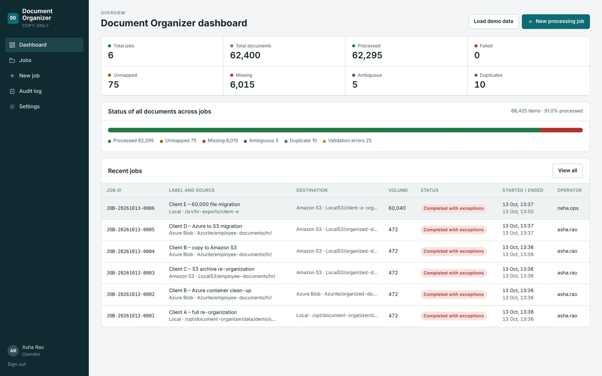

# Document Organizer

Re-organizes employee documents into a clean folder structure such as `EmployeeCode / DocumentType / Year / FileName`, driven by a mapping file (Excel or CSV) that describes each document.

It works with **Azure Blob Storage**, **Amazon S3** (and S3-compatible storage such as MinIO, Wasabi or Cloudflare R2) and **local or network folders**, in any combination: Azure → Azure, S3 → S3, Azure → S3, S3 → local folder, and so on.

It is **copy-only**: source documents are never moved, changed or deleted.

- No database server: SQLite through the operating system library.
- No third-party packages: Azure Blob and S3 are called through their REST APIs (Shared Key / SAS / Entra ID, and AWS Signature Version 4).
- Runs on Windows, Linux and macOS, or in a container.

## Documentation

Full guides are in [`docs/`](docs/README.md), as Markdown and PDF: [User Guide](docs/user-guide.md), [Installation and Administration](docs/installation-and-administration.md), [Quick Start](docs/quick-start.md), [FAQ and Troubleshooting](docs/faq-and-troubleshooting.md), [Technical Design](docs/technical-design.md), [UAT Test Cases](docs/uat-test-cases.md) and [Release Notes v2.0](docs/release-notes.md).



## How it works

1. **Create a job.** Choose a source and a destination: an Azure Blob container, an S3 bucket (each with an optional prefix), or a folder. Access is checked before the job is saved.
2. **Upload the mapping file** (`.xlsx` or `.csv`). The header row and columns are detected automatically, and you can change any column mapping. See [Mapping file](#mapping-file).
3. **Set the rules:**
   - Year source: UploadedOn, a Year column, a file-name pattern, or a path pattern.
   - Folder template, e.g. `{EmployeeCode}/{DocumentType}/{Year}/{FileName}`.
   - Matching options (exact, case-insensitive, normalized).
   - Duplicate rule: Skip and report, Rename, Compare hash, or Overwrite (Overwrite needs an administrator to allow it).
   - Integrity check: SHA-256, Content-MD5 or none.
4. **Scan and validate.** Every source file and every mapping record gets a status: `READY`, `UNMAPPED`, `MISSING`, `AMBIGUOUS`, `DUPLICATE` or `INVALID` (for example a blank EmployeeCode or Type, a missing year, a 0-byte file, or an object in an archive tier). Nothing is guessed.
5. **Review.** Counts, exceptions with search and filters, and a preview of the output structure. Resolve ambiguous files by choosing the right record. Download the validation report.
6. **Approve.** Copying runs in batches.
   - Within the same Azure storage account, or the same S3 connection, the app uses **server-side copy**: documents never pass through the app.
   - Across providers (e.g. Azure → S3) it streams the copy; files over 8 MiB go to S3 as multipart uploads.
   - The source ETag is checked so a file that changed after the scan is not copied.
   - Integrity is verified, and cloud destinations get metadata with the Job ID, record ID and employee code.
7. **Pause, resume and retry.** Progress is saved continuously. After a restart the job is marked *Paused*. On resume, files already copied are verified and not copied again.
8. **Reconciliation report** (Excel or CSV) for every item, with integrity hashes and source ETag.
9. **Dashboard and audit log** of sign-ins, jobs, approvals, settings and user changes.

**Roles:** Administrator (settings and users), Operator (create, scan, resolve, approve, retry, export), Viewer (read-only).

## Quick start

### Windows

Requires the [.NET 8 SDK](https://dotnet.microsoft.com/download/dotnet/8.0).

```bat
start.cmd
```

### Linux / macOS

Requires the .NET 8 SDK and `libsqlite3` (pre-installed on macOS and most Linux distributions).

```bash
DOCORG_ADMIN_PASSWORD='Choose-A-Strong-Pass-1' ./start.sh
```

Open http://localhost:5080 and sign in as **admin**. If you don't set `DOCORG_ADMIN_PASSWORD`, a temporary password is printed in the console on first run. Change it under **Settings → My password**.

### Docker (with Azure and S3 emulators)

```bash
cp .env.example .env        # then set DOCORG_ADMIN_PASSWORD
docker compose up --build
```

Open http://localhost:8080. The compose file starts Azurite (Azure Blob emulator) and MinIO (S3) next to the app, so you can try every storage type without a cloud account.

### Try it with demo data

On the dashboard, choose **Load demo data**. It creates about 470 fictional files and a matching mapping file that exercise every status. The files are written to a local folder and also uploaded to every connection marked `"UseForDemo": true` that is reachable (Azurite and MinIO by default). On the **New job** page, use the buttons to fill in the demo locations, then choose **Use demo mapping file**.

To run the emulators without Docker:

```bash
npm install -g azurite && azurite-blob --silent --location ./.azurite        # Azure Blob on :10000
# S3 on :9000 — either MinIO (https://min.io) or:
pip install "moto[server]" && moto_server -p 9000
```

## Mapping file

One row per document. Column names are matched automatically (common alternatives in brackets) and can be changed in the app.

| Field | Required | Typical column names |
|---|---|---|
| Employee code | Yes | `EmployeeCode` (`EmpCode`, `EmployeeID`, `EmpID`) |
| Document type | Yes | `Type` (`DocumentType`, `DocType`, `Category`) |
| File name | Yes | `FileName` (`PhysicalFileName`, `FilePath`, `StoredFileName`) — a bare name, or a relative path |
| Uploaded on | When the year comes from it | `UploadedOn` (`UploadDate`, `CreatedOn`) |
| Year | When the year comes from it | `Year` (`DocumentYear`, `FinancialYear`) |
| Record ID | No | `ID` (`RecordID`, `DocumentID`) — kept for reconciliation |
| Employee name, Document name, Description, Module, Sub-module | No | `EmployeeName`, `Name`, `Description`, `ModuleCode`, `SubModuleCode` |

A small example is in [`samples/sample-mapping.csv`](samples/sample-mapping.csv).

Folder-template tokens: `{EmployeeCode}` `{DocumentType}` `{Year}` `{FileName}` `{ModuleCode}` `{SubModuleCode}` `{DocumentName}` `{EmployeeName}`.

## Storage connections

Cloud connections are named under `DocumentOrganizer:StorageConnections` in `src/DocumentOrganizer/appsettings.json`. Each has a `Provider` of `AzureBlob` or `S3`.

**Keep secrets out of the file and out of Git.** Use environment variables (a double underscore separates levels), for example:

```bash
DocumentOrganizer__StorageConnections__Prod-S3__SecretAccessKey=...
DocumentOrganizer__StorageConnections__Prod-Azure__SasToken=...
```

or an `appsettings.Production.json` file next to `appsettings.json` (loaded automatically, and excluded from Git by `.gitignore`). Secrets are never stored in the job database or written to logs.

The two connections in the default `appsettings.json` (`Azurite`, `LocalS3`) point at local emulators; remove them for production.

### Azure Blob Storage

```jsonc
"StorageConnections": {
  // Laptop: uses your `az login` account (Microsoft Entra ID)
  "Prod-Azure":    { "Provider": "AzureBlob", "AccountUrl": "https://mystorageacct.blob.core.windows.net", "Auth": "AzureCli" },

  // Azure App Service / VM: managed identity (recommended)
  "Prod-Azure-MI": { "Provider": "AzureBlob", "AccountUrl": "https://mystorageacct.blob.core.windows.net", "Auth": "ManagedIdentity" },

  // SAS token (read + list on the source; add write on the destination container)
  "Client-SAS":    { "Provider": "AzureBlob", "AccountUrl": "https://acct.blob.core.windows.net", "Auth": "Sas", "SasToken": "" },

  // Connection string with an account key
  "Legacy-Key":    { "Provider": "AzureBlob", "ConnectionString": "" }
}
```

Least-privilege roles: **Storage Blob Data Reader** on the source container and **Storage Blob Data Contributor** on the destination container. Server-side copy needs source and destination in the same storage account. Archive-tier blobs are reported as exceptions and never rehydrated automatically.

### Amazon S3 and S3-compatible storage

```jsonc
"StorageConnections": {
  // AWS, credentials from the default chain (see below) — recommended when hosted on AWS
  "Prod-S3":   { "Provider": "S3", "Region": "ap-south-1" },

  // AWS with an access key (put the secret in an environment variable)
  "Client-S3": { "Provider": "S3", "Region": "eu-west-1", "AccessKeyId": "AKIA...", "SecretAccessKey": "" },

  // S3-compatible service (MinIO, Wasabi, Cloudflare R2, ...): set ServiceUrl
  "MinIO":     { "Provider": "S3", "ServiceUrl": "https://minio.example.com", "AccessKeyId": "...", "SecretAccessKey": "" }
}
```

| Setting | Meaning |
|---|---|
| `Region` | Bucket region. Defaults to `AWS_REGION` / `AWS_DEFAULT_REGION`, then `us-east-1`. A wrong region gives a clear error naming the right one. |
| `ServiceUrl` | Endpoint for S3-compatible services. Leave empty for AWS. |
| `ForcePathStyle` | `endpoint/bucket/key` URLs. Default: `true` with `ServiceUrl`, `false` for AWS. |
| `Auth` | `AccessKey` (default when `AccessKeyId` is set) or `Default` (otherwise). Also `Environment`, `Profile`, `WebIdentity`, `Container`, `InstanceProfile` to force one source. |
| `Profile` | Profile in `~/.aws/credentials` (default: `AWS_PROFILE`, then `default`). |
| `SessionToken` | For temporary keys. |

The **default credential chain** tries, in order: `AWS_ACCESS_KEY_ID` / `AWS_SECRET_ACCESS_KEY` environment variables → web identity (EKS IRSA: `AWS_WEB_IDENTITY_TOKEN_FILE` + `AWS_ROLE_ARN`) → static keys in `~/.aws/credentials` → container role (ECS / EKS Pod Identity) → EC2 instance role (IMDSv2).

Least-privilege IAM policy:

```json
{
  "Version": "2012-10-17",
  "Statement": [
    { "Sid": "ReadSource", "Effect": "Allow", "Action": ["s3:ListBucket", "s3:GetObject"],
      "Resource": ["arn:aws:s3:::source-bucket", "arn:aws:s3:::source-bucket/*"] },
    { "Sid": "WriteDestination", "Effect": "Allow", "Action": ["s3:ListBucket", "s3:GetObject", "s3:PutObject", "s3:DeleteObject", "s3:AbortMultipartUpload"],
      "Resource": ["arn:aws:s3:::destination-bucket", "arn:aws:s3:::destination-bucket/*"] }
  ]
}
```

- `s3:ListBucket` on the destination is needed so that "does this file already exist?" returns *not found* rather than *access denied*.
- `s3:DeleteObject` is only used to remove the app's own write-test object when you check access. The app never deletes documents.
- Add `s3:CreateBucket` only if you want the app to create a missing destination bucket.

Server-side copy (`CopyObject`) is used when the source and destination use the same connection. Objects in **Glacier Flexible Retrieval** or **Deep Archive** are reported as exceptions and never restored automatically. Glacier Instant Retrieval is read normally.

## Hosting

- **Container:** the `Dockerfile` builds a small image that listens on port 8080 and keeps its database in the `/app/data` volume. Configure everything through environment variables.
- **Behind HTTPS:** for anything other than a single laptop, put it behind a reverse proxy or load balancer that terminates HTTPS, and set `DocumentOrganizer:BehindReverseProxy=true` so client IPs and the HTTPS scheme are recognised.
- **Health check:** `GET /healthz` returns `200 {"status":"ok"}` without authentication.
- **Single instance:** jobs run in the background inside the app and state lives in SQLite, so run one instance per data volume.
- **Local folders on a server:** set `AllowedLocalRoots` so users can only reach the folders you intend.

## Settings

`appsettings.json` (or environment variables):

| Setting | Default | Meaning |
|---|---|---|
| `Urls` | `http://localhost:5080` | Listen address. The Docker image sets `http://+:8080`. |
| `DocumentOrganizer:DataPath` | `data` | Database, uploaded mapping files and demo data. |
| `DocumentOrganizer:SessionTimeoutMinutes` | `30` | Sign-out after inactivity. |
| `DocumentOrganizer:AllowedLocalRoots` | `[]` | Folders that may be used as local sources/destinations. Empty = any. |
| `DocumentOrganizer:EnableDemoData` | `true` | Set to `false` in production. |
| `DocumentOrganizer:BehindReverseProxy` | `false` | Trust `X-Forwarded-For` / `X-Forwarded-Proto`. |

In the app under **Settings** (administrators): allow overwrite, parallel copies (default 8), job and audit retention, and enabling Azure Blob, S3 and local folders individually.

## Tests

`tests/e2e.mjs` (Node 18+) runs the full flow and checks counts, matching rules, ambiguity resolution, reports, integrity hashes, the CSRF guard and role restrictions:

```bash
node tests/e2e.mjs http://localhost:5080 <admin-password> all     # local | cloud | all
```

`cloud` runs a job for every reachable demo connection, each cloud → local folder, and Azure ↔ S3 in both directions. The GitHub Actions workflow in `.github/workflows/ci.yml` builds the app and runs these tests against Azurite and moto on every push.

## Security notes

- Passwords are hashed with PBKDF2-SHA256 (210,000 iterations). An account locks for 10 minutes after 5 failed sign-ins.
- The session cookie is HttpOnly with SameSite=Strict and expires after the inactivity timeout.
- State-changing API calls require a custom header (CSRF guard).
- A strict Content Security Policy is set, and nothing loads from external hosts.
- Local paths are confined to their root, and destination-inside-source is rejected.
- CSV exports escape formula characters.
- Documents are never sent to any external service.

## Project layout

```
src/DocumentOrganizer/
  Program.cs                 host, authentication, security headers, health check
  Api/Endpoints.cs           REST API
  Engine/                    Mapping (xlsx/csv, columns, year rules, template), Scanner (match + validate),
                             Processor (batch copy), JobService (background runs), Reports, DemoData
  Storage/                   LocalStore, AzureBlobStore (Shared Key, SAS, managed identity, Azure CLI),
                             S3Store (Signature V4, multipart, CopyObject), AwsCredentials (credential chain)
  Infrastructure/            SQLite (OS library), xlsx/csv reader-writer, database schema, users
  wwwroot/                   web UI (HTML/CSS/JS, no external assets)
docs/                        user, admin, technical and test documentation (Markdown + PDF)
samples/                     example mapping file
tests/e2e.mjs                end-to-end API test
Dockerfile, docker-compose.yml
```
