# User Guide

## 1 About this guide

This guide walks through every screen of Document Organizer in the order you meet them when you run a job. Each screen has a screenshot with numbered markers, and a table that explains every marked item.


### 1.1 What Document Organizer does

Document Organizer copies employee documents into a clean folder structure: `EmployeeCode / DocumentType / Year / FileName`. It uses a mapping file, usually the document log exported from the HR system where the documents were uploaded, to decide where each file belongs.

The documents can be in **Azure Blob Storage**, **Amazon S3** (or S3-compatible storage such as MinIO, Wasabi or Cloudflare R2), or a **local or network folder**. The organized copy can go to any of the three, so you can also use a job to move documents from one storage to another, for example from Azure to S3.

For example, the mapping record for employee E00879, document type *Medical Certificate*, uploaded on 25-Nov-2021, with file name `e00879_final_certificate.pdf`, is copied to:

```
E00879/Medical Certificate/2021/e00879_final_certificate.pdf
```

> [!IMPORTANT]
> **Three rules the application always follows**
>
> - **Copy only.** The original files are read, never moved, changed or deleted.
> - **No guessing.** A file that cannot be placed with certainty is flagged for a person to decide.
> - **Everything is accounted for.** Every file and every mapping record ends with a status and appears in the reports.

### 1.2 Who should read it

| Reader | Sections to read |
|---|---|
| Operators (team members who run jobs) | All sections |
| Viewers (team leads, auditors, account managers) | 2, 3, 4, 10, 12, 13 and 15 |
| Administrators | All sections, plus the Installation and Administration Guide (DO-IG-02) |

### 1.3 How to read the screenshots

Orange numbered markers on a screenshot point to the item described in the matching row of the table below it. The orange outline shows the exact area the marker refers to. Names of buttons and fields are shown in **bold**.

> [!NOTE]
> **Sample data**
>
> The screenshots use the built-in demo data and a test job of 60,000 files. All employee codes, names, file names and client names in them are fictional.

### 1.4 Key terms

| Term | Meaning |
|---|---|
| Job | One run that organizes one set of documents, from a source to a destination, with its own rules and reports. |
| Source | Where the documents are today: an Azure Blob container, an S3 bucket (each with an optional prefix) or a folder. Only read. |
| Destination | Where the organized copy is written. Must be separate from the source. |
| Mapping file | A spreadsheet (`.xlsx` or `.csv`) with one row per document. It says which employee and document type each file belongs to. |
| Container / bucket | The top-level storage area in Azure Blob Storage (container) or Amazon S3 (bucket). |
| Prefix | A "virtual folder" inside a container or bucket, for example `hr/`. |
| Storage connection | A named, pre-configured link to an Azure storage account or an S3 account. Set up by your administrator. |
| Status | The result for each file or mapping record, for example READY, UNMAPPED or PROCESSED. See section 15. |

## 2 Getting started

### 2.1 Opening the application and signing in

Open the link your administrator gives you. On a laptop installation it is http://localhost:5080. The sign-in page opens.

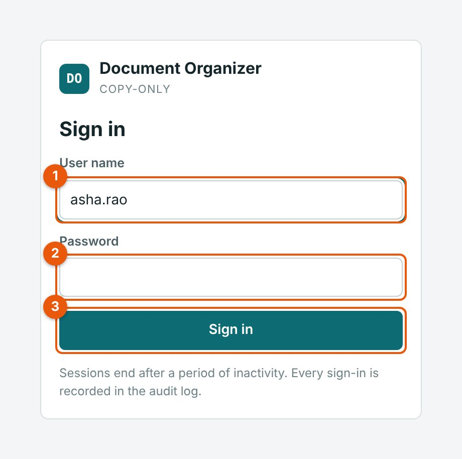

| # | Item | What to do |
|---|---|---|
| 1 | **User name** | Type the user name your administrator created for you. |
| 2 | **Password** | Type your password. Passwords are case-sensitive. |
| 3 | **Sign in** | Click to sign in. You land on the dashboard. |

> [!WARNING]
> **If sign-in fails**
>
> After 5 wrong passwords the account is locked for 10 minutes. Ask an administrator to reset your password if you have forgotten it. Every sign-in, successful or not, is recorded in the audit log.

### 2.2 Screen layout

Every page has the same layout: the navigation bar on the left, the page title at the top, and the page content below it.

| Menu item | What it opens | Who sees it |
|---|---|---|
| Dashboard | Totals across all jobs and the most recent jobs | Everyone |
| Jobs | The full list of jobs | Everyone |
| New job | Starts a new processing job | Operators and administrators |
| Audit log | Every action taken in the application | Everyone |
| Settings | Settings, users and your password | Everyone (changes: administrators only) |

### 2.3 Roles and what you can do

| Action | Viewer | Operator | Administrator |
|---|---|---|---|
| View dashboard, jobs, results and audit log | Yes | Yes | Yes |
| Download validation and reconciliation reports | Yes | Yes | Yes |
| Create jobs, upload mapping files, set rules, scan | No | Yes | Yes |
| Resolve ambiguous files, approve, pause, resume, retry | No | Yes | Yes |
| Delete a job | No | Own draft jobs | Any job |
| Change settings, manage users | No | No | Yes |

### 2.4 Signing out and session timeout

Click **Sign out** at the bottom of the navigation bar. If you do nothing for 30 minutes (your administrator can change this) you are signed out automatically, and the next click takes you to the sign-in page. A job that is running keeps running after you sign out.

## 3 Dashboard

The dashboard gives an overview of all jobs: how many documents have been processed, how many need attention, and the latest jobs.

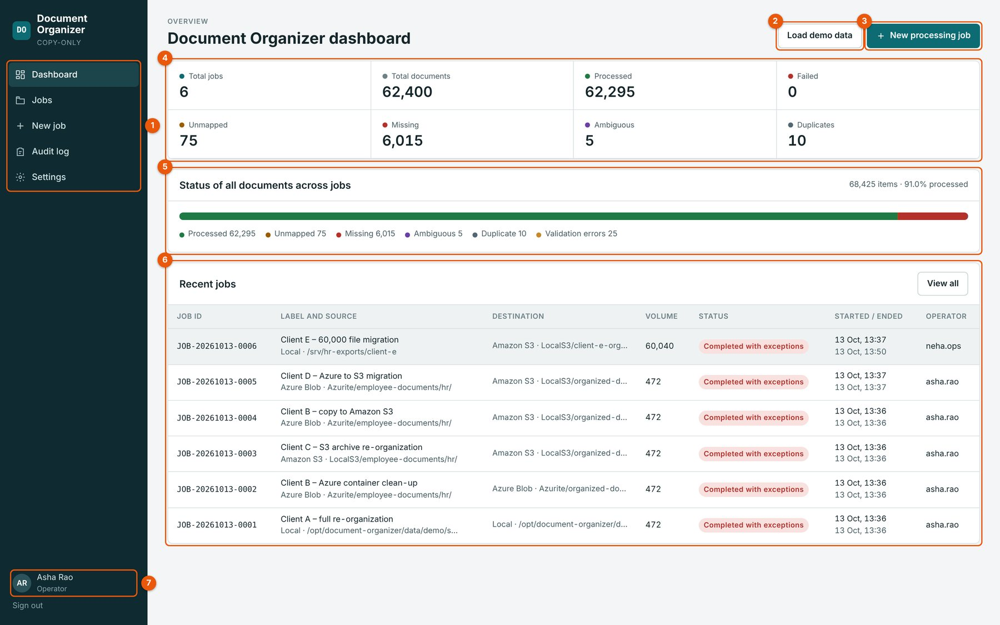

| # | Item | Description |
|---|---|---|
| 1 | Navigation bar | Moves between Dashboard, Jobs, New job, Audit log and Settings. |
| 2 | **Load demo data** | Creates fictional practice files and a matching mapping file so you can try the full flow safely. See Appendix A. Shown only when demo data is enabled. |
| 3 | **New processing job** | Starts a new job (section 5). Operators and administrators only. |
| 4 | Totals | Total jobs, total documents found in sources, and totals per status across all jobs: Processed, Failed, Unmapped, Missing, Ambiguous and Duplicates. |
| 5 | Status of all documents | A bar showing the share of each status across all jobs, with counts in the legend. |
| 6 | Recent jobs | The latest jobs with job ID, label and source, destination, volume (files found), status, start and end time, and operator. Click a row to open the job. |
| 7 | Signed-in user | Your name and role. **Sign out** is just below. |

> [!TIP]
> **Reading the totals**
>
> "Missing" counts mapping records whose file was not found in the source. A large number usually means the source prefix or folder was too narrow, not that files are lost. Check the job's exception list before reporting to the client.

## 4 Jobs list

**Jobs** lists every job, newest first. Click any row to open that job at its current step.

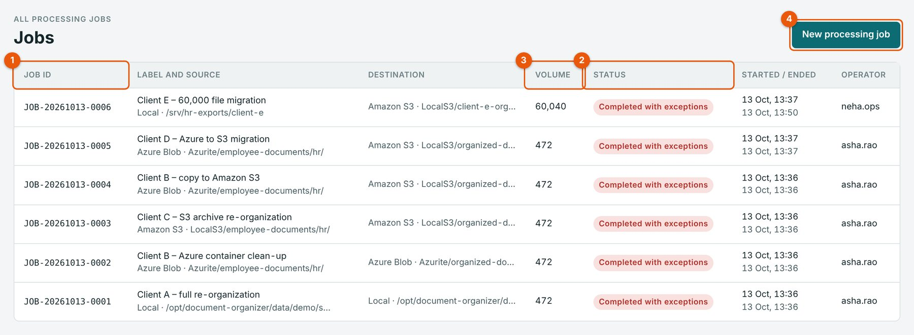

| # | Item | Description |
|---|---|---|
| 1 | Job ID | A unique ID in the form `JOB-YYYYMMDD-NNNN`. Quote it when you ask for help. |
| 2 | Status | Where the job is. See the table below. |
| 3 | Volume | Number of files found in the source by the scan. |
| 4 | **New processing job** | Starts a new job. |

| Job status | Meaning | What you can do |
|---|---|---|
| Draft | Created; the mapping file and rules are being set up, or the rules were changed after a scan. | Continue the setup and scan. |
| Scanning | The source is being listed and matched. | Wait; you can leave the page. |
| Awaiting approval | Scan finished. Results are ready for review. | Review, resolve, download the validation report, approve. |
| Processing | Files are being copied. | Watch progress or pause. |
| Paused | Copying was paused by a user or interrupted by a restart. | Resume. |
| Completed | Every item finished with no exceptions. | Download the reconciliation report. |
| Completed with exceptions | Copying finished; some items need follow-up (for example unmapped or missing). | Download the reports; retry failed files if any. |

## 5 Creating a job: source and destination

A job goes through eight steps, shown in the step bar at the top of the job page. This section covers step 1. Click **New job** (or **New processing job** on the dashboard).

### 5.1 Choose the source

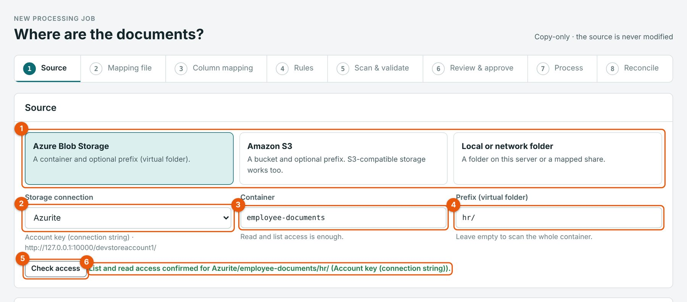

| # | Item | What to do |
|---|---|---|
| 1 | Storage type | Choose **Azure Blob Storage**, **Amazon S3** or **Local or network folder**. A type is greyed out if your administrator has turned it off or no connection of that type is configured. |
| 2 | **Storage connection** | Pick the storage account. Connections are set up by your administrator; only connections of the chosen type are listed. The line below shows how the application signs in and the account address. |
| 3 | **Container** (Azure) or **Bucket** (S3) | The container or bucket that holds the documents, for example `employee-documents`. |
| 4 | **Prefix (virtual folder)** | The folder inside the container or bucket, for example `hr/`. Leave it empty to scan everything. |
| 5 | **Check access** | Tests that the application can list and read the source. |
| 6 | Result | Green text confirms access. Red text explains the problem, for example a wrong name, a bucket in another region, or a missing permission. |

For a folder source, type the full path instead, for example `D:\HRDocs\ClientA` or `/srv/hr-exports/client-a`. It is scanned including all sub-folders.

### 5.2 Choose the destination and name the job

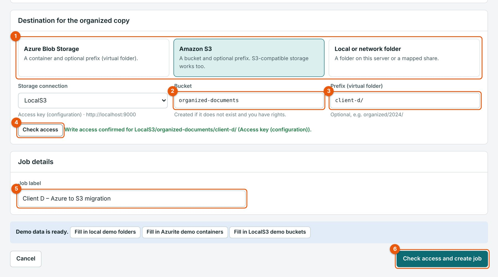

| # | Item | What to do |
|---|---|---|
| 1 | Storage type | Choose where the organized copy is written. It can be the same type as the source or different (for example Azure source, S3 destination). |
| 2 | **Container** / **Bucket** | The destination container or bucket, for example `organized-documents`. It is created if it does not exist and the connection has the rights. |
| 3 | **Prefix** | Optional folder inside the destination, for example `client-d/`. |
| 4 | **Check access** | Tests that the application can write to the destination. A small test file is written and removed. |
| 5 | **Job label** | A short name your team will recognise, for example "Client D – Azure to S3 migration". |
| 6 | **Check access and create job** | Checks both locations again and creates the job. You move to step 2. |

> [!IMPORTANT]
> **The destination must be separate from the source**
>
> The application refuses a destination folder inside the source folder, or a destination prefix inside the source prefix in the same container or bucket. This prevents the organized copy from being picked up by a later scan.

### 5.3 Filling in the demo locations

After **Load demo data** has been used, a blue bar appears on this page.

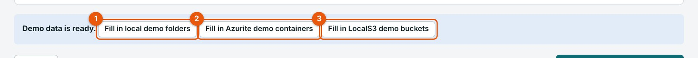

| # | Item | Description |
|---|---|---|
| 1 | **Fill in local demo folders** | Fills in the demo source and destination folders on the application server. |
| 2 | **Fill in … demo containers** | Fills in the demo Azure containers. Shown for each Azure connection marked for demo use that was running when the demo data was loaded (for example the Azurite emulator). |
| 3 | **Fill in … demo buckets** | The same for S3 connections marked for demo use (for example MinIO). |

## 6 Uploading the mapping file

Step 2 asks for the mapping file: a spreadsheet with one row per document, usually the document log exported from the HR system as-is.

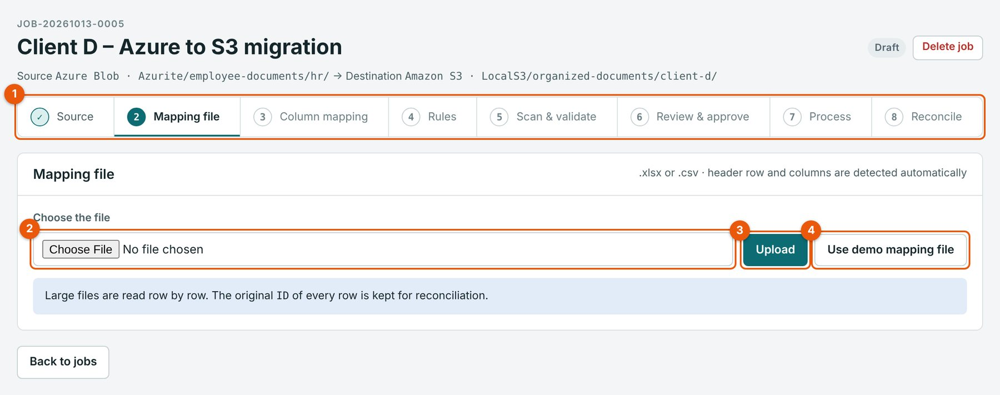

| # | Item | What to do |
|---|---|---|
| 1 | Step bar | Shows the eight steps. Completed steps have a tick. You can click steps 2 to 4 to go back while the job is not yet approved. |
| 2 | **Choose the file** | Select the mapping file (`.xlsx` or `.csv`). Files up to 300 MB are accepted. |
| 3 | **Upload** | Uploads and reads the file. A 176,000-row Excel file takes about 3 seconds. |
| 4 | **Use demo mapping file** | Uses the demo mapping file (practice only). |

After the upload the page shows what was found:

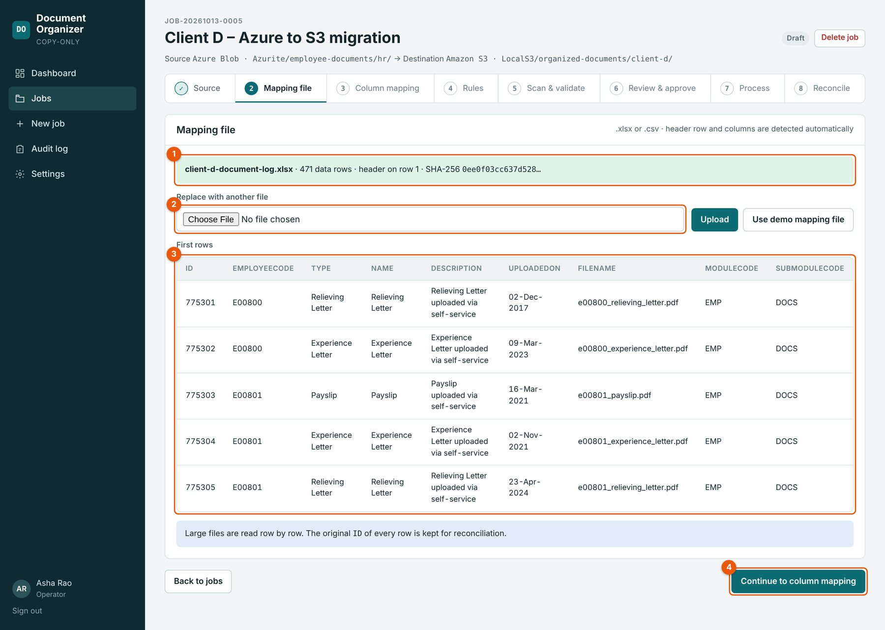

| # | Item | Description |
|---|---|---|
| 1 | File summary | File name, number of data rows, the row where the column headers were found, and the file's SHA-256 fingerprint (recorded in the audit log and reports). |
| 2 | **Replace with another file** | Choose and upload a different file. Uploading again after a scan clears the scan results. |
| 3 | First rows | The first five data rows, so you can confirm it is the right file. |
| 4 | **Continue to column mapping** | Moves to step 3. |

> [!TIP]
> **No reformatting needed**
>
> The application finds the header row by itself, even if the export has title rows above it. Dates in Excel date format and text dates such as `25-Nov-2021` are both understood.

## 7 Mapping the columns

Step 3 links each column in the mapping file to the field the application needs. Columns are matched automatically by name; you only change a row when the file uses a different column name.

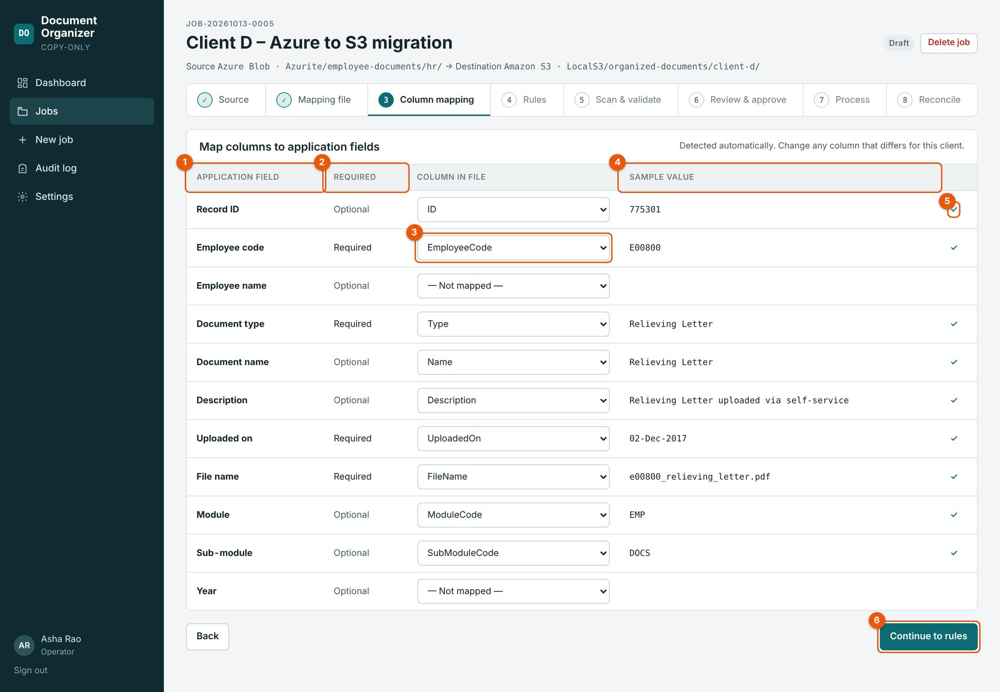

| # | Item | Description |
|---|---|---|
| 1 | Application field | What the application needs, for example Employee code. |
| 2 | Required / Optional | Employee code, Document type and File name are always required. Uploaded on is required when the year comes from UploadedOn; Year is required when the year comes from a Year column. |
| 3 | Column in file | The column used for this field. Choose another column or **— Not mapped —**. |
| 4 | Sample value | The value in the first data row, to confirm the choice. |
| 5 | Check | A tick when the field is mapped; **Missing** in red when a required field is not mapped. |
| 6 | **Continue to rules** | Moves to step 4. |

| Application field | Typical column names | Used for |
|---|---|---|
| Record ID | `ID`, `RecordID`, `DocumentID` | Traceability in reports. If missing, the row number is used. |
| Employee code | `EmployeeCode`, `EmpCode`, `EmployeeID` | First folder level. |
| Employee name | `EmployeeName`, `EmpName` | Reports, optional template token. |
| Document type | `Type`, `DocumentType`, `DocType`, `Category` | Second folder level. |
| Document name | `Name`, `DocumentName`, `Title` | Reports, optional template token. |
| Description | `Description`, `Remarks` | Reports. |
| Uploaded on | `UploadedOn`, `UploadDate`, `CreatedOn` | Year (default rule). |
| File name | `FileName`, `PhysicalFileName`, `FilePath` | Matching mapping records to files. A bare name or a relative path. |
| Module / Sub-module | `ModuleCode` / `SubModuleCode` | Reports and optional template tokens. |
| Year | `Year`, `DocumentYear`, `FinancialYear` | Year (when the Year column rule is chosen). |

## 8 Setting the rules

Step 4 decides how the year is worked out, how folders are named, how files are matched, what happens when a file already exists at the destination, and how copies are verified.

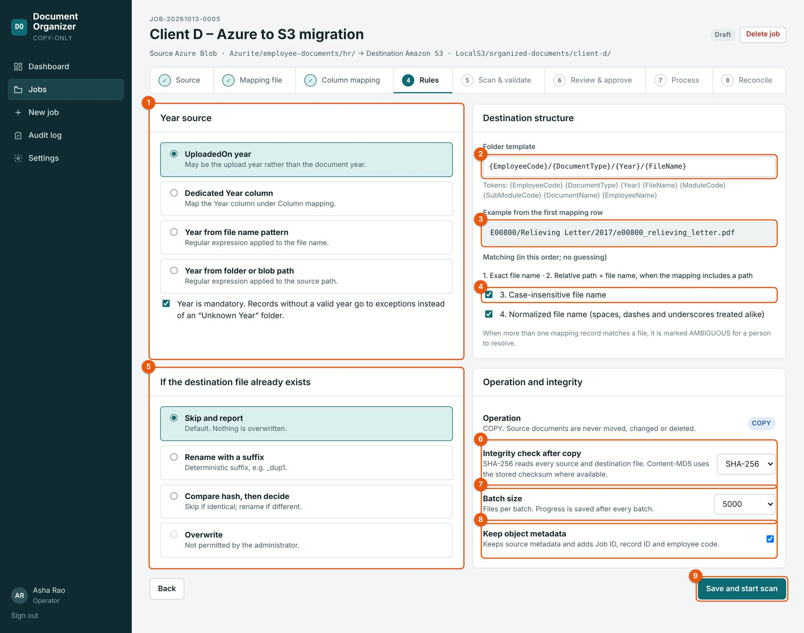

| # | Item | Description |
|---|---|---|
| 1 | Year source | **UploadedOn year** (default), **Dedicated Year column**, **Year from file name pattern** or **Year from folder or blob path**. For the two pattern options, a **Pattern** box appears; the first 4-digit year found is used. Below it, **Year is mandatory** sends records without a valid year to exceptions instead of an "Unknown Year" folder. |
| 2 | **Folder template** | How destination paths are built. Default: `{EmployeeCode}/{DocumentType}/{Year}/{FileName}`. Available tokens are listed under the box. It must end with `{FileName}`. |
| 3 | Example | The destination path the template gives for the first mapping record. It updates as you type. |
| 4 | Matching options | Exact file name and path matching always apply. **Case-insensitive file name** and **Normalized file name** (spaces, dashes and underscores treated alike) are on by default. |
| 5 | If the destination file already exists | **Skip and report** (default), **Rename with a suffix** (`_dup1`, `_dup2`), **Compare hash, then decide** (skip if identical, rename if different) or **Overwrite** (only when an administrator allows it). |
| 6 | **Integrity check after copy** | **SHA-256** (strongest; reads every file twice), **Content-MD5** (uses the checksum the storage already holds where it can, which is cheaper on Azure and for single-part S3 objects) or **None**. |
| 7 | **Batch size** | Files per batch (1,000, 5,000 or 10,000). Progress is saved after every batch. |
| 8 | **Keep object metadata** | Cloud destinations only. Keeps the source object's metadata and adds the job ID, record ID and employee code to each copied file. |
| 9 | **Save and start scan** | Saves the rules and starts step 5. |

> [!NOTE]
> **Changing rules later**
>
> You can come back to steps 2 to 4 until the job is approved. Saving changed rules clears the scan results, and you scan again. After approval the rules are locked, so each job's report always matches the rules it ran with.

## 9 Scanning and validating

Step 5 runs by itself. The application reads the mapping file, lists every file in the source, matches files to mapping records and checks each one. You can leave the page; the scan continues in the background.

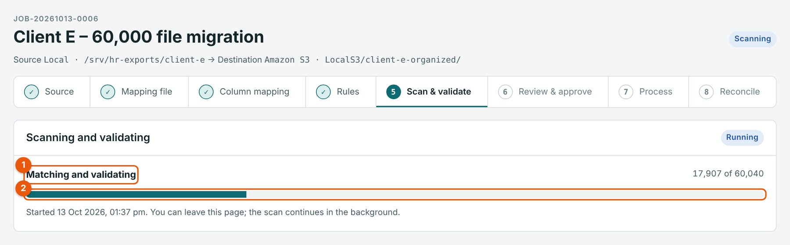

| # | Item | Description |
|---|---|---|
| 1 | Current phase | Reading mapping file, Listing source documents, Matching and validating, then Saving results. |
| 2 | Progress | Items handled so far. |

In testing, a 66,000-row mapping file with 60,000 files was scanned and validated in about 3 seconds from a local folder. Cloud sources take longer because files are listed in pages (5,000 per page on Azure, 1,000 per page on S3).

What is checked: blank employee code, type or file name; a missing or unreadable year; duplicate mapping records; the same file found twice; two files that would land on the same destination path; empty (0-byte) files; files in an archive tier (Azure Archive, S3 Glacier Flexible Retrieval or Deep Archive); and mapping records whose file is not in the source.

## 10 Reviewing and approving

When the scan finishes the job shows **Awaiting approval** and step 6 opens. Nothing is copied until you approve.

### 10.1 Results summary

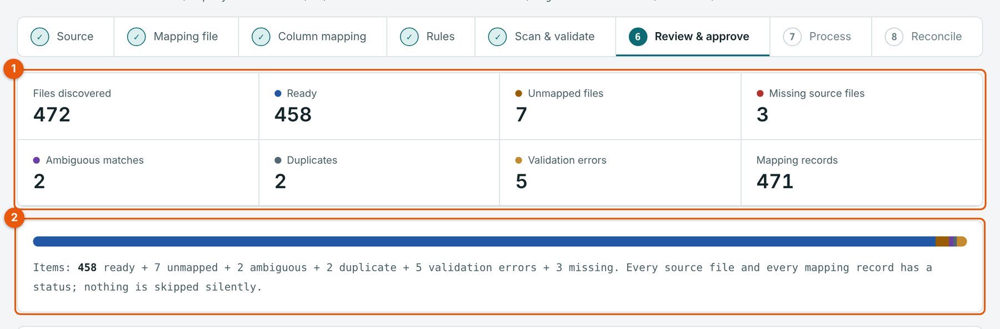

| # | Item | Description |
|---|---|---|
| 1 | Counts | Files discovered, Ready, Unmapped files, Missing source files, Ambiguous matches, Duplicates, Validation errors and Mapping records. Click a coloured tile to filter the table below to that status. |
| 2 | Check bar and line | The share of each status, and a line showing that every file and record is counted once. |

### 10.2 Exceptions and results

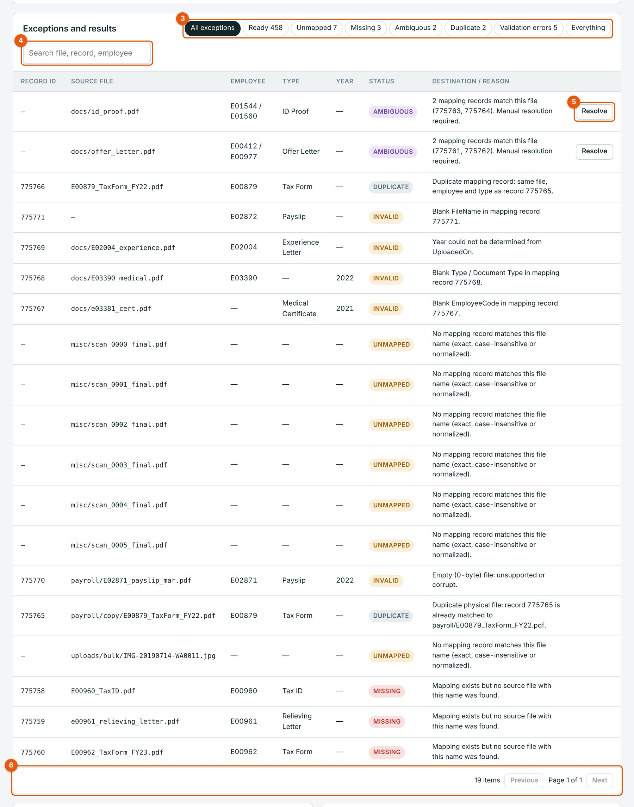

| # | Item | Description |
|---|---|---|
| 3 | Filters | **All exceptions** (default), one tab per status with its count, or **Everything**. |
| 4 | Search | Finds items by file name, record ID, employee code or destination path. |
| 5 | **Resolve** | Shown on AMBIGUOUS items. Opens the resolve panel (section 10.3). |
| 6 | Pages | 50 items per page; use **Previous** and **Next**. |

The **Destination / reason** column shows the proposed destination path for READY items, and the reason for every exception in plain words.

### 10.3 Resolving an ambiguous file

A file is AMBIGUOUS when more than one mapping record names it, for example `id_proof.pdf` for two different employees. The application will not choose; a person must.

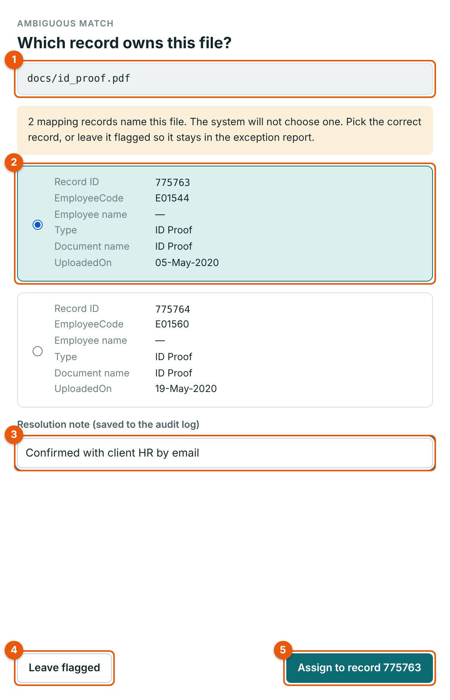

| # | Item | What to do |
|---|---|---|
| 1 | File | The file that needs a decision, with its location. |
| 2 | Candidate records | Each mapping record that names this file, with record ID, employee code and name, type, document name and upload date. Select the correct one. |
| 3 | **Resolution note** | Say how you decided, for example "Confirmed with client HR by email". Saved in the audit log. |
| 4 | **Leave flagged** | Closes the panel without a decision. The file stays AMBIGUOUS and is not copied. |
| 5 | **Assign to record …** | Assigns the file. It becomes READY, or DUPLICATE if that record or destination is already taken. |

### 10.4 Checking the output and approving

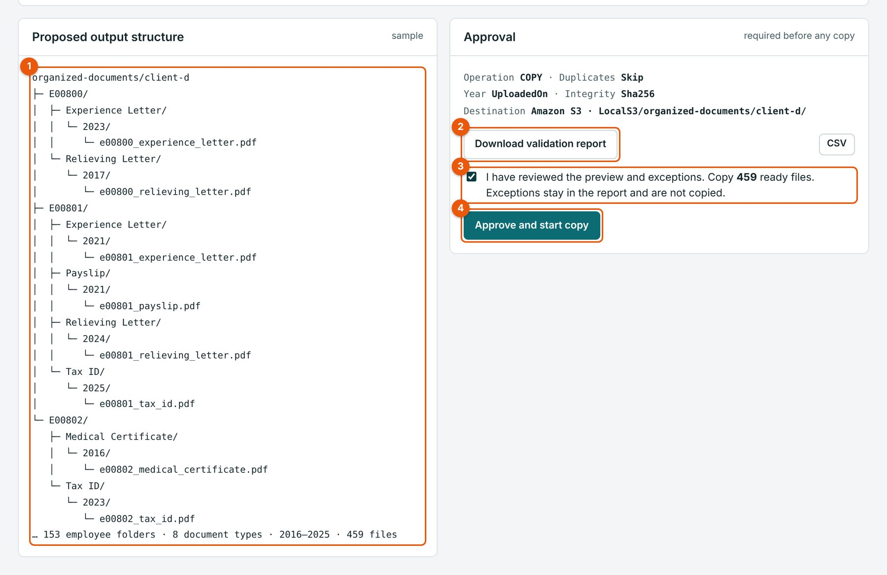

| # | Item | Description |
|---|---|---|
| 1 | Proposed output structure | A sample of the destination folders for the first employees, and totals: employee folders, document types, year range and files. |
| 2 | **Download validation report** | Excel (or **CSV**) list of every item with its status and reason. Use it to agree exceptions with the client before copying. |
| 3 | Confirmation | Tick to confirm you reviewed the preview and exceptions. |
| 4 | **Approve and start copy** | Opens the confirmation below. |

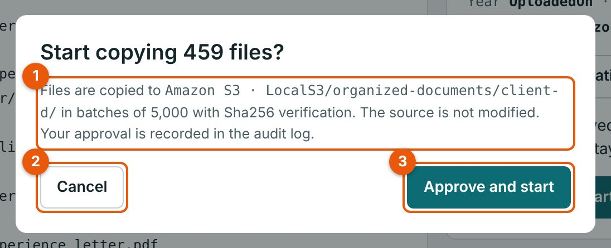

| # | Item | Description |
|---|---|---|
| 1 | Summary | Number of files, the destination, batch size and integrity check. |
| 2 | **Cancel** | Goes back without copying. |
| 3 | **Approve and start** | Records your approval (name and time) in the audit log and starts copying. |

## 11 Processing (copying)

Step 7 copies READY files in batches. When source and destination are in the same Azure storage account, or use the same S3 connection, files are copied inside the storage service and never pass through the application server. Otherwise (for example Azure to S3) the application streams each file from the source to the destination.

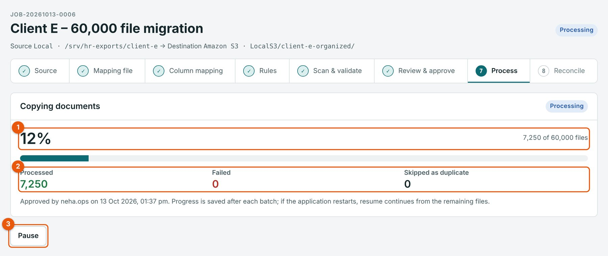

| # | Item | Description |
|---|---|---|
| 1 | Progress | Percentage and number of files done out of the total. |
| 2 | Counts | Processed (copied and verified), Failed, and Skipped as duplicate (the file already existed at the destination). |
| 3 | **Pause** | Stops after the files in progress finish. |

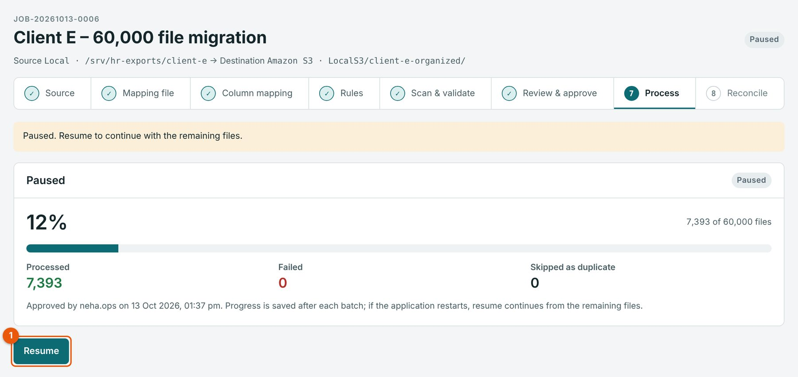

| # | Item | Description |
|---|---|---|
| 1 | **Resume** | Continues with the remaining files. Files already copied are not copied again. |

> [!NOTE]
> **If the application or server restarts**
>
> A job that was copying is shown as **Paused** with a message. Open it and click **Resume**. Files that were copied just before the restart are recognised (by comparing their contents) and recorded as processed, not copied twice.

A file is not copied, and is marked FAILED, if it changed or was removed after the scan. This protects against copying a different version from the one you approved.

## 12 Reconciliation and reports

When copying finishes the job moves to step 8.

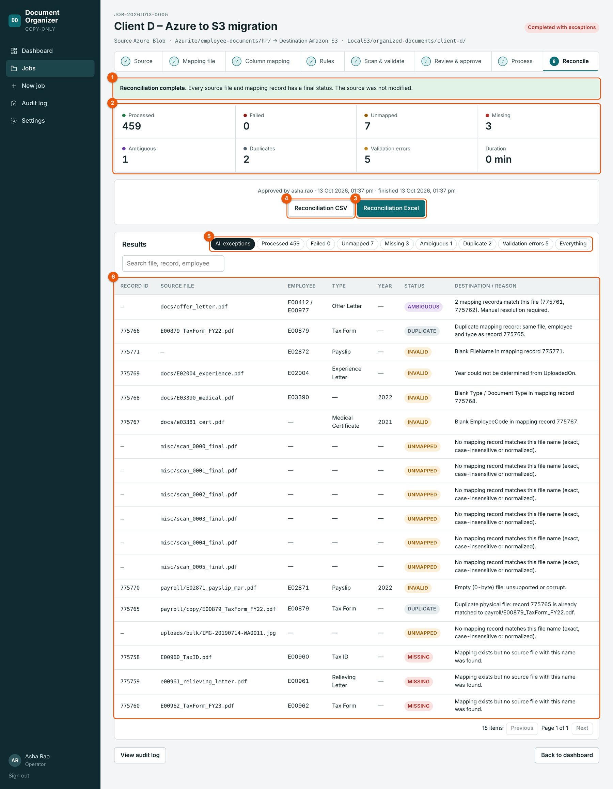

| # | Item | Description |
|---|---|---|
| 1 | Result | Green when every item has a final status; amber when some files failed and can be retried. |
| 2 | Final counts | Processed, Failed, Unmapped, Missing, Ambiguous, Duplicates, Validation errors and Duration. Click a tile to filter the results. |
| 3 | **Reconciliation Excel** | Downloads the full report with a Summary sheet. |
| 4 | **Reconciliation CSV** | The same data as CSV. |
| 5 | Filters | Show exceptions, one status, or everything. |
| 6 | Results table | Every item with its destination (processed) or reason (exceptions). |

When files failed, a **Retry N failed** button appears. Retrying copies only the failed files, using the current version of each file in the source. Files already processed are left alone.

### 12.1 What the reports contain

| Report | Contents |
|---|---|
| Validation report (before approval) | Summary sheet (job, source, destination, mapping file and fingerprint, rules, counts) and one row per item: item ID, status, reason, record ID, employee code and name, document type and name, description, uploaded on, year, source file and path, proposed destination, size, access tier. |
| Reconciliation report (after copying) | Summary sheet plus one row per item: job ID, record ID, employee code and name, document type and name, description, uploaded on, source file and path, destination path, year, status, exception reason, source hash, destination hash, integrity method, source ETag, processed time (UTC) and processed by. |

## 13 Audit log

The audit log records every sign-in, job creation, connection check, mapping upload, configuration change, scan, resolution, approval, run, pause, resume, retry, report download, settings change and user change.

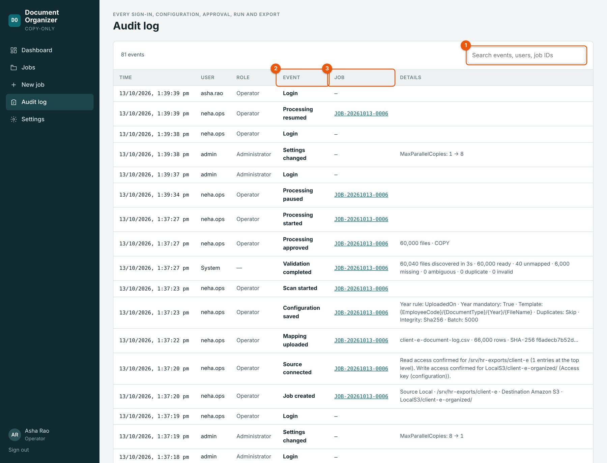

| # | Item | Description |
|---|---|---|
| 1 | Search | Finds events by event name, user, job ID or details. |
| 2 | Event | What happened, for example Processing approved or Ambiguity resolved. |
| 3 | Job | The job the event belongs to. Click it to open the job. |

The log is shown newest first, 100 events per page. It cannot be edited from the application and is kept for 7 years by default.

## 14 Settings

**Settings** shows the application settings to everyone; only administrators can change them. Every change is recorded in the audit log.

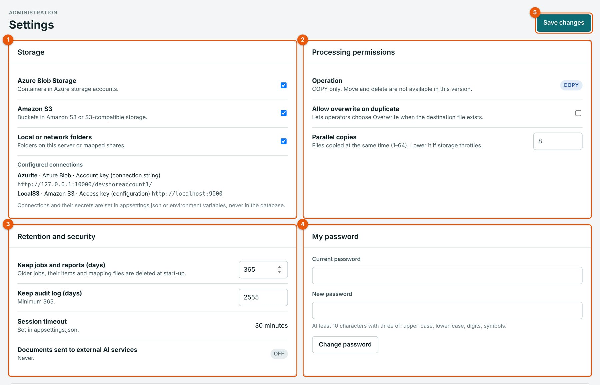

| # | Item | Description |
|---|---|---|
| 1 | Storage | Turns Azure Blob Storage, Amazon S3 and local folders on or off, and lists the configured storage connections, their type and how each signs in. |
| 2 | Processing permissions | The COPY-only operation, **Allow overwrite on duplicate**, and **Parallel copies** (how many files are copied at the same time, 1 to 64). |
| 3 | Retention and security | How long jobs, reports and the audit log are kept, and the session timeout. |
| 4 | My password | Change your own password: current password, new password, **Change password**. |
| 5 | **Save changes** | Saves the settings (administrators). |

### 14.1 Users and roles (administrators)

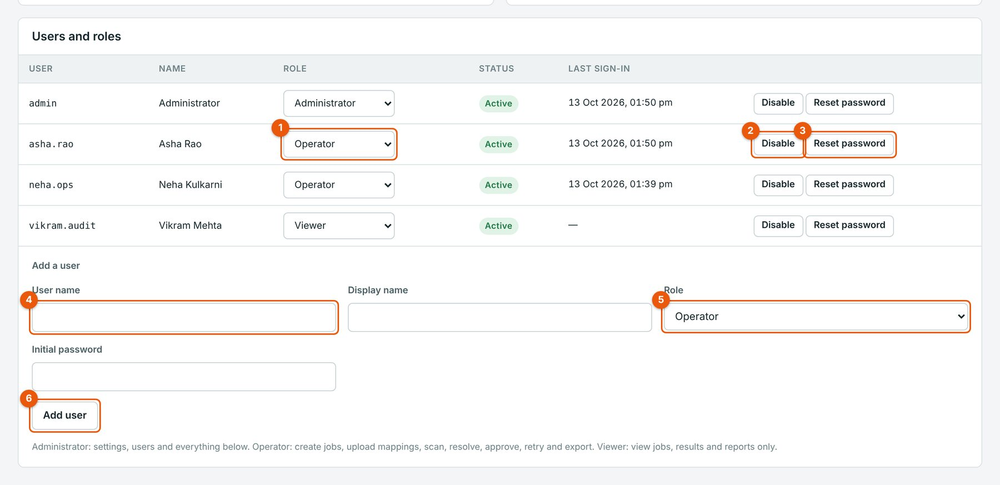

| # | Item | What to do |
|---|---|---|
| 1 | Role | Change a user's role. It takes effect on their next click. |
| 2 | **Disable** / **Enable** | Blocks or restores a user's access. Their history stays in the audit log. |
| 3 | **Reset password** | Sets a new password for the user. Share it securely. |
| 4 | **User name** (and **Display name**) | For a new user: 3 to 64 letters, digits, dot, dash, underscore or @. |
| 5 | **Role** | Operator, Viewer or Administrator. |
| 6 | **Add user** | Creates the user with the **Initial password**. |

Passwords need at least 10 characters with three of: upper-case, lower-case, digits and symbols.

## 15 Status reference

Every source file and every mapping record ends with exactly one status. Only READY files are copied.

| Status | Meaning | What to do |
|---|---|---|
| READY | The file matched one record and passed every check. | Nothing. It is copied after approval. |
| PROCESSED | Copied and verified. | Nothing. |
| UNMAPPED | A file in the source has no matching mapping record. | Check with the client or the data team whether the record is missing from the mapping file. |
| MISSING | A mapping record has no matching file in the source. | Check whether the file is in another container, bucket, prefix or folder. |
| AMBIGUOUS | More than one mapping record names the same file. | Resolve it (section 10.3) or leave it flagged. |
| DUPLICATE | A repeated mapping record, a second copy of the same file, two files that would land on the same path, or a file already at the destination. | Read the reason. Usually no action; the first copy is kept. |
| INVALID | A validation error: blank employee code, type or file name; no usable year; an empty file; or a file in an archive tier. | Fix the mapping file or the file, upload the corrected mapping file and scan again. |
| FAILED | The copy did not succeed, for example storage was busy or the file changed after the scan. | Click **Retry failed**. |

## 16 Glossary

| Term | Meaning |
|---|---|
| Azure Blob Storage | Microsoft's cloud file storage. Files live in containers inside a storage account. |
| Amazon S3 | Amazon Web Services' cloud file storage. Files (objects) live in buckets. Many other services (MinIO, Wasabi, Cloudflare R2) offer the same interface. |
| Azurite | Microsoft's free Azure Storage emulator, used for testing on a laptop. |
| MinIO | A free S3-compatible storage server, used here as a local S3 emulator for testing. |
| Content-MD5 | A checksum stored with many files; used as a cheaper integrity check. |
| ETag | A version marker of a file. A changed ETag means the file changed after the scan. |
| Archive tier | Low-cost storage that must be restored before files can be read: Azure Archive tier, S3 Glacier Flexible Retrieval and S3 Glacier Deep Archive. Not restored automatically. |
| Server-side copy | A copy made inside the storage service, without the content passing through the application. |
| SHA-256 | A fingerprint of a file's contents; identical files have identical SHA-256 values. |

## 17 Appendix A: practise with demo data

The demo creates about 470 fictional files and a matching mapping file that produce every status. It does not touch real data.

1. On the dashboard, click **Load demo data** (Figure 3, marker 2).
2. On the **New job** page, click **Fill in local demo folders** (or one of the demo container or bucket buttons if an emulator is running).
3. Click **Check access and create job**.
4. On step 2, click **Use demo mapping file**, then **Continue to column mapping** and **Continue to rules**.
5. Keep the default rules and click **Save and start scan**.
6. On step 6 you should see 472 files discovered, 471 mapping records, 458 ready, 7 unmapped, 3 missing, 2 ambiguous, 2 duplicate and 5 validation errors.
7. Resolve one ambiguous file (459 ready), tick the confirmation, approve, and download the reconciliation report.

Loading demo data again replaces the earlier demo files. Turn demo data off on production installations (Installation and Administration Guide, section 4.1).
